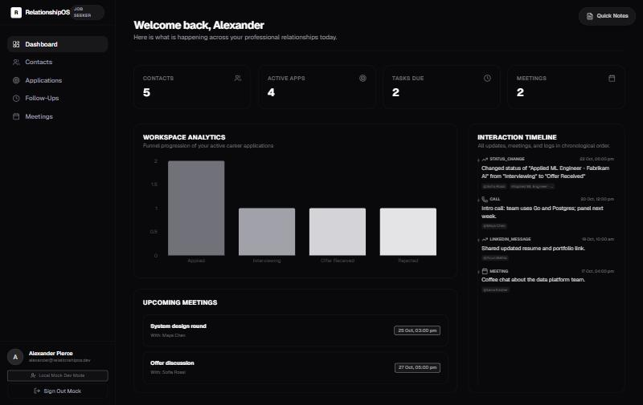
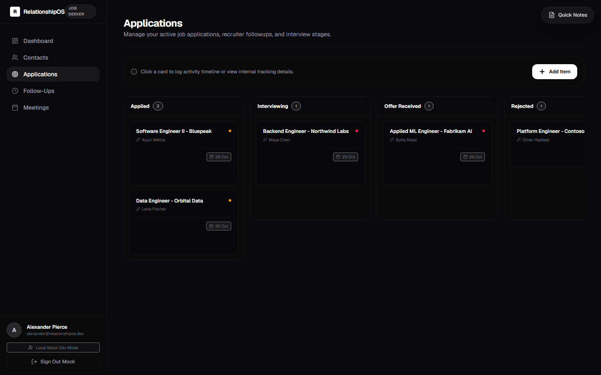
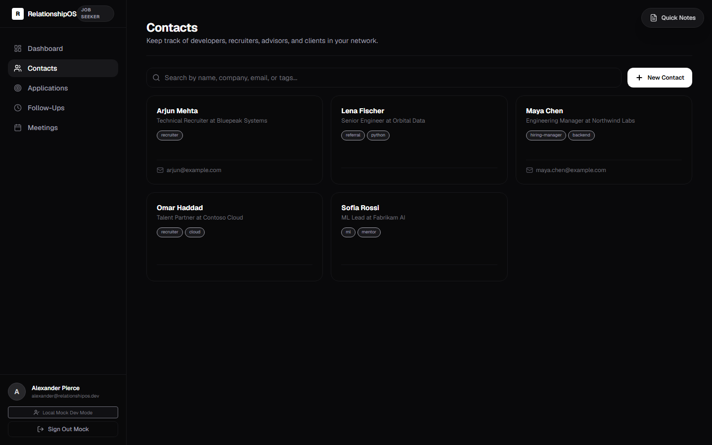

# RelationshipOS

A personal CRM that adapts to how you work. Pick a role when you first sign in (**Job Seeker**,
**Freelancer** or **Founder**) and the app changes its pipeline stages and wording to match:
*Applications* for a job search, *Projects* for client work, *Opportunities* for fundraising.



| Pipeline board | Contacts |
|---|---|
|  |  |

*Screenshots use fictional demo data (`npm run db:seed`).*

## Features

- **Contacts:** company, role, email, phone, LinkedIn, tags, notes, search, and a per-contact interaction timeline
- **Pipeline:** role-specific stages, priority, value in ₹, next action date, board view
- **Follow-ups:** due dates, overdue highlighting, mark done
- **Meetings:** participants, notes, action items
- **Dashboard:** key counts, pipeline funnel chart, upcoming meetings, activity feed
- **Automatic activity log:** creating a contact, changing a status or completing a follow-up adds a timeline entry
- **Quick Notes:** a scratchpad available on every page, saved automatically

**Stack:** Next.js 16 (App Router, Server Actions), React 19, TypeScript, PostgreSQL + Prisma 7,
Clerk authentication with Svix-verified webhooks, Tailwind CSS 4, Radix UI, Recharts,
zod validation, Vitest.

## How this was built

The first version was generated with an AI coding agent (Google Antigravity) from my product idea
and requirements. I then reviewed it, with AI assistance, and fixed what was wrong. The git history
starts with the unmodified generated code, so every change is visible:

| Problem in the generated version | Effect | Fix |
|---|---|---|
| Notes saved with the Clerk id where the database expects the profile id | **Every note save failed** with a foreign-key error | Use the profile id; regression test |
| Actions accepted a `contactId`, `opportunityId` or meeting participant id without checking ownership (IDOR) | A user could link **another user's contact** to their own record and read its details back | `assertOwned()` inside every action; 6 isolation tests |
| No input validation in Server Actions, which are reachable by direct POST | Any shape of data reached the database | zod schemas for every action |
| Record and its timeline entry written separately | A failure could leave a half-saved record | One database transaction |
| Profile created only by the Clerk webhook | New users got **stuck on onboarding** if the webhook hadn't run | Create the profile on first sign-in |
| No Clerk keys meant one shared user, even in production | A deployed site would let **anyone in** | Refused in production (HTTP 503) unless `ALLOW_DEMO_MODE=true` |
| 4 TypeScript errors | **`next build` failed**: production builds were impossible | Fixed; CI builds on every push |
| "Upcoming Meetings" showed the 3 *oldest* meetings | Past meetings shown as upcoming | Query future meetings only |
| Next.js 16 deprecated `middleware.ts` | Deprecation warning | Renamed to `proxy.ts` |
| 10 lint errors, 27 warnings; no tests; template README | — | 0 lint issues, 29 tests, this README |

I checked that the new tests catch the original bugs by running them against the generated code:
all 6 cross-account linking tests fail there, and the notes test fails with the foreign-key error.

## Security model

- **Authentication:** Clerk, with `proxy.ts` as the first gate.
- **Authorization:** checked inside every Server Action, not just on pages, because actions can be
  called directly. Every query is filtered by the signed-in user, and every *referenced* record
  (a contact on an opportunity, meeting participants, …) is checked for ownership.
- A missing record and someone else's record return the same "not found", so ids can't be probed.
- Webhooks are verified with Svix signatures. Unsigned webhooks are only accepted in local development.

## Run it locally

Requires Node.js 20.9+. No Postgres install or Clerk account needed.

```bash
npm install
npx prisma dev --name ros --detach        # local Postgres; prints a DATABASE_URL
cp .env.example .env                       # paste that URL into DATABASE_URL
npm run db:deploy                          # create the tables
npm run db:seed                            # optional: fictional demo data
npm run dev                                # http://localhost:3000
```

Without Clerk keys the app runs as a local demo user. To use real sign-in, add your Clerk keys to
`.env` (see `.env.example`).

## Tests

The tests run against a real Postgres database, a **separate** one from development:

```bash
npx prisma dev --name ros-test --detach    # second local database
# put its URL in TEST_DATABASE_URL in .env, then:
DATABASE_URL="<test url>" npm run db:deploy
npm test
```

| File | What it covers |
|---|---|
| `tests/isolation.test.ts` | User B can't read, change or link user A's contacts, opportunities, follow-ups, meetings or interactions |
| `tests/actions.test.ts` | Notes regression, timeline logging, transactions, input validation |
| `tests/auth.test.ts` | Profile created on first sign-in; demo user refused in production |

CI (GitHub Actions) runs the type check, lint, tests against a Postgres service, a production build,
and a gitleaks secret scan on every push.

## Known limitations

- Money values use `Float`. A `Decimal` column would avoid rounding, but would need serialization
  changes in the client components.
- Pipeline stages are fixed per role, not user-editable.
- No rate limiting on Server Actions.
- The local `prisma dev` database accepts one connection at a time, so keep `DATABASE_POOL_MAX=1`
  for it. Real Postgres doesn't need this.
